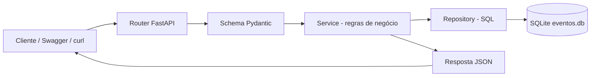
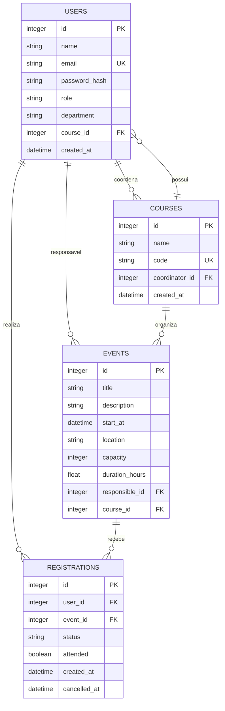

# Como funciona o Sistema de Eventos Acadêmicos

Este documento explica o projeto de forma prática e também serve como roteiro para apresentar o trabalho em sala. A aplicação foi desenvolvida com **Python**, **FastAPI** e **SQLite**. Ela permite administrar usuários, cursos, eventos acadêmicos, inscrições, presenças e certificados.

## 1. Visão geral

O sistema representa uma faculdade que oferece cursos e organiza eventos. Cada usuário possui um perfil, cada evento pode estar ligado a um curso e os participantes podem se inscrever. Professores e administradores controlam os eventos e confirmam presenças.

O fluxo principal é:



A separação existe para facilitar a manutenção. A rota recebe a requisição, o schema valida os dados, o serviço aplica as regras e o repositório conversa com o banco.

## 2. Como iniciar

### Linux ou macOS

```bash
python3 -m venv .venv
source .venv/bin/activate
pip install -r requirements.txt
export EVENTOS_SECRET_KEY="coloque-uma-chave-grande-aqui"
python popular_banco.py --recriar
uvicorn main:app --reload
```

### Windows PowerShell

```powershell
python -m venv .venv
.venv\Scripts\Activate.ps1
pip install -r requirements.txt
$env:EVENTOS_SECRET_KEY = "coloque-uma-chave-grande-aqui"
python popular_banco.py --recriar
uvicorn main:app --reload
```

Depois, abra:

- Swagger: <http://127.0.0.1:8000/docs>
- Redoc: <http://127.0.0.1:8000/redoc>
- Saúde da aplicação: <http://127.0.0.1:8000/health>

O comando `popular_banco.py --recriar` limpa o banco e cria novamente os dados de demonstração. Sem `--recriar`, ele tenta manter os cadastros que já existem.

## 3. O que é criado no banco

A base de demonstração contém:

- 80 usuários: 1 administrador, 9 professores e 70 participantes;
- 8 cursos de graduação e tecnologia;
- 22 eventos, alguns já realizados e outros futuros;
- 135 inscrições;
- inscrições ativas e canceladas;
- presenças confirmadas para testar certificados.

O banco é o arquivo `eventos.db`. Ele é criado automaticamente pelo `schema.sql` quando a API inicia. As chaves estrangeiras ficam ativadas em cada conexão para impedir relacionamentos inválidos.

## 4. Relacionamento das tabelas



### Regras dos relacionamentos

- O e-mail do usuário é único.
- `department` identifica o setor acadêmico ou administrativo do usuário e é
  devolvido no perfil autenticado, sem expor a senha ou o hash.
- O código do curso é único.
- Um usuário pode estar vinculado a um curso.
- Um evento possui um responsável, que deve ser administrador ou professor.
- Uma inscrição liga um usuário a um evento.
- A combinação usuário + evento não pode se repetir.
- Um evento com inscrições ativas não pode ser excluído.

### Campos da tabela `users`

| Campo | Tipo | Finalidade |
|---|---|---|
| `id` | INTEGER | Identificador interno e referência usada pelo JWT |
| `name` | TEXT | Nome completo do usuário |
| `email` | TEXT UNIQUE | Identificador usado no login |
| `password_hash` | TEXT | Hash PBKDF2-SHA256; a senha original nunca é salva |
| `role` | TEXT | `participante`, `professor` ou `admin` |
| `department` | TEXT | Departamento/setor acadêmico ou administrativo |
| `course_id` | INTEGER | Curso relacionado, quando existir |
| `created_at` | TEXT | Data de criação em UTC |

## 5. Cadastro e login

O cadastro é feito em `POST /api/v1/usuarios`:

```json
{
  "name": "Maria Oliveira",
  "email": "maria.oliveira@aluno.faculdade.edu",
  "password": "Maria123",
  "role": "participante",
  "department": "Graduação",
  "course_id": 1
}
```

A senha não é armazenada diretamente. O sistema gera um hash PBKDF2-SHA256 com salt aleatório e salva apenas esse resultado na coluna `password_hash`.

Depois do cadastro, o usuário faz login:

```bash
curl -X POST http://127.0.0.1:8000/api/v1/auth/login \
  -H "Content-Type: application/json" \
  -d '{"email":"maria.oliveira@aluno.faculdade.edu","password":"Maria123"}'
```

A API devolve um JWT. O token deve ser enviado nas rotas protegidas:

```bash
curl http://127.0.0.1:8000/api/v1/auth/me \
  -H "Authorization: Bearer SEU_TOKEN_AQUI"
```

O JWT contém o identificador do usuário, o horário de emissão e o horário de expiração. A assinatura usa HS256 e a chave vem de `EVENTOS_SECRET_KEY`.

## 6. Perfis e permissões

### Participante

Pode consultar cursos e eventos, fazer a própria inscrição, consultar suas inscrições, cancelar dentro do prazo e emitir certificados quando tiver presença confirmada.

### Professor

Pode cadastrar cursos e eventos, além de editar eventos sob sua responsabilidade. Também pode controlar presença e administrar inscrições relacionadas aos seus eventos.

### Administrador

Possui as permissões dos demais perfis e também pode administrar qualquer evento e consultar o relatório geral do banco.

## 7. Fluxo de inscrição

1. O usuário consulta os eventos em `GET /api/v1/eventos`.
2. Escolhe um evento futuro com vaga disponível.
3. Envia `POST /api/v1/inscricoes` com `user_id` e `event_id`.
4. O serviço verifica o token, a identidade do usuário, a existência do evento, a capacidade e a duplicidade.
5. A inscrição é gravada em uma transação SQLite.
6. Se o usuário tentar se inscrever novamente, a API responde `409 Conflict`.

Exemplo:

```json
{
  "user_id": 7,
  "event_id": 5
}
```

O participante não pode criar inscrição em nome de outra pessoa. Administradores e professores podem atuar em situações administrativas autorizadas.

## 8. Presença e certificado

Depois que o evento acontece, um administrador ou professor responsável pode confirmar a presença:

```http
PATCH /api/v1/inscricoes/{id}/presenca
```

```json
{
  "attended": true
}
```

O certificado é liberado em:

```http
GET /api/v1/inscricoes/{id}/certificado
```

Para emitir o certificado, a inscrição precisa estar ativa e possuir presença confirmada. A resposta inclui o identificador do certificado, o nome do participante, o evento e a carga horária.

## 9. Dashboard pessoal

O endpoint `GET /api/v1/dashboard` mostra um resumo individual:

- quantidade total de inscrições;
- inscrições ativas;
- presenças confirmadas;
- certificados disponíveis;
- próximos eventos inscritos.

Cada usuário recebe somente os seus próprios dados.

## 10. Relatório administrativo

Administradores podem consultar:

```http
GET /api/v1/relatorios/resumo
```

O retorno agrega os dados diretamente no SQLite e apresenta:

- totais de usuários, cursos, eventos e inscrições;
- quantidade de eventos futuros e finalizados;
- inscrições ativas e canceladas;
- presenças confirmadas;
- usuários agrupados por perfil;
- eventos agrupados por curso.

Esse endpoint é útil para demonstrar que o projeto não possui apenas cadastros isolados: ele também transforma os dados armazenados em informações de acompanhamento.

## 11. Filtros disponíveis

Usuários:

```text
GET /api/v1/usuarios?busca=Ana&role=participante&course_id=1
```

Eventos:

```text
GET /api/v1/eventos?busca=Python&futuros=true&limit=10&offset=0
```

Inscrições:

```text
GET /api/v1/inscricoes?status=inscrita&event_id=5
```

As listagens usam `limit` e `offset` para evitar que uma consulta grande devolva todos os registros de uma vez.

## 12. Tratamento de erros

A aplicação utiliza respostas HTTP coerentes:

- `201 Created`: cadastro realizado;
- `200 OK`: consulta ou alteração concluída;
- `204 No Content`: exclusão concluída;
- `400 Bad Request`: regra de negócio violada;
- `401 Unauthorized`: token ausente, inválido ou expirado;
- `403 Forbidden`: usuário autenticado, mas sem permissão;
- `404 Not Found`: registro não encontrado;
- `409 Conflict`: conflito, como e-mail ou inscrição duplicada;
- `422 Unprocessable Entity`: dados de entrada inválidos.

## 13. Como explicar a arquitetura na apresentação

Uma forma simples de apresentar o trabalho é:

1. O cliente envia uma requisição para uma rota FastAPI.
2. O Pydantic valida o formato dos dados.
3. A dependência de segurança verifica o JWT quando a rota é protegida.
4. O service aplica as regras de negócio.
5. O repository executa o SQL parametrizado.
6. O SQLite confirma ou desfaz a transação.
7. A API devolve uma resposta JSON sem expor a senha ou o hash.

Essa divisão mostra que o projeto possui organização por responsabilidades, não apenas um arquivo único com todas as operações.

## 14. Testes

Testes unitários e de integração:

```bash
python -m unittest discover -s app/tests -t . -v
```

Backtest HTTP, com a API rodando em outro terminal:

```bash
python executar.py
python backtest_api.py
```

Os testes cobrem autenticação, segurança, permissões, CRUDs, regras de inscrição, filtros, dashboard, relatório e privacidade dos dados.
